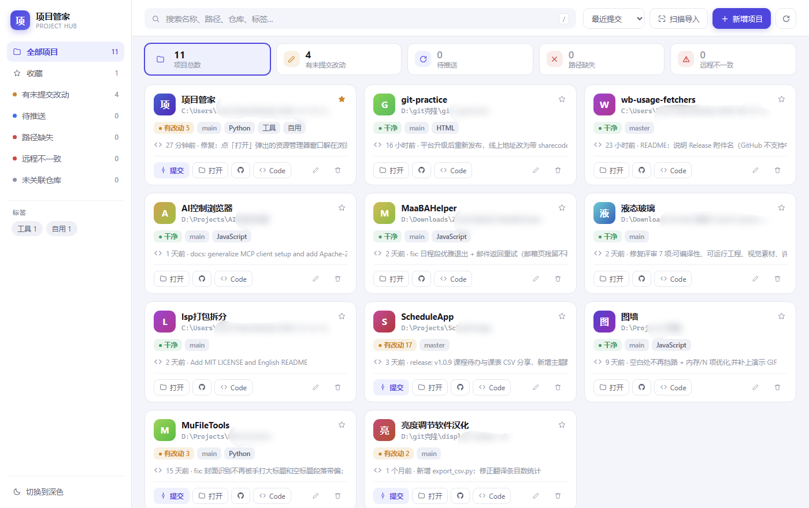
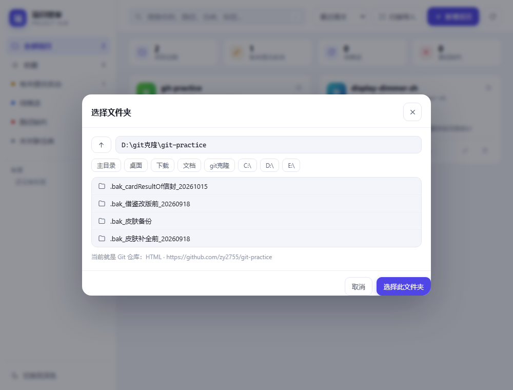
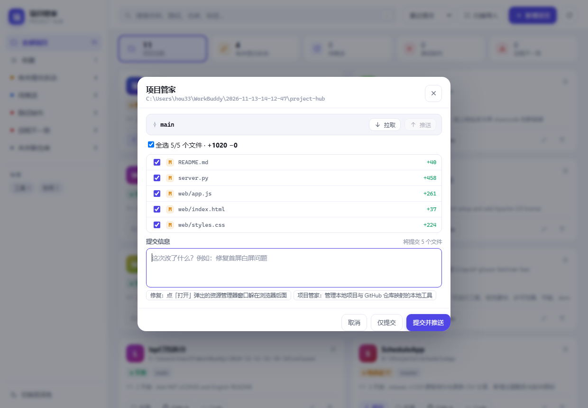
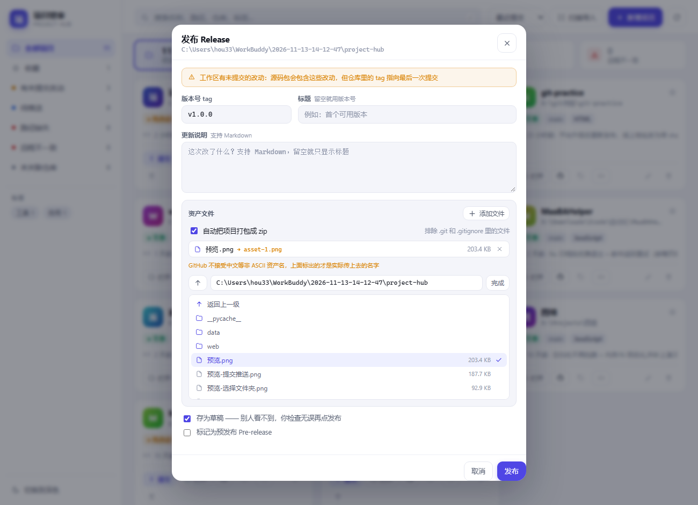

# 项目管家 · Project Hub

> 管「本地项目文件夹」和「对应 GitHub 仓库」的对应关系。
> 日常操作全在本机（只有推送和发布 Release 才联网），零第三方依赖，数据只存在你自己的硬盘上。



选文件夹用的是内置目录浏览器，Git 仓库会标绿：



---

## 怎么启动

| 方式 | 适合场景 |
|---|---|
| 双击 **`启动项目管家.bat`** | 日常用。会留一个黑窗口显示日志，关掉即退出 |
| 双击 **`静默启动.vbs`** | 后台跑，不弹黑框。适合做成开机自启 |
| 命令行 `python server.py` | 调试用。加 `--no-open` 参数可以不自动打开窗口 |

启动后会自动用 **Edge 的应用窗口模式**打开（没有地址栏和标签页，看起来就是个独立软件）。
如果你把它都关了想再打开：再次双击 bat 就行 —— **不会重启服务**，只是再开一个窗口。

> **环境要求**：Python 3.10+、Git（状态探测要用到 `git` 命令）。
> **不需要装任何第三方包**，也不需要 Node。Windows 上双击 bat 即可，其他系统跑 `python3 server.py`。
>
> **发布 Release 额外需要** GitHub CLI（`gh`），并且 `gh auth login` 登录过。
> 没有的话其他功能照常，只是发布面板会提示装一个 —— 它比让程序自己存 token 省事，
> 也不用你把密码交出来。
>
> **隐私**：登记的项目清单存在 `data/projects.json`，只在本机，已被 `.gitignore` 排除，
> 不会跟着仓库上传。想备份就复制这一个文件。

---

## 它能干什么

**1. 登记项目**
「新增项目」填本地路径 + GitHub 地址。路径旁的「浏览…」会打开一个**内置目录浏览器**
（在窗口里直接点，不会跳系统对话框），里面会把已经是 Git 仓库的文件夹标成绿色，
进去选中就自动把 GitHub 地址和主语言填好。也可以直接把路径粘进输入框按回车跳转。

**2. 扫描导入（最省事）**
点「扫描导入」→ 选一个放代码的总目录（比如 `D:\git克隆`）→ 它会往下翻指定层数，
把每个含 `.git` 的文件夹连 GitHub 地址一起列出来，勾选导入。已收录的会自动标出来不重复加。

**3. 一眼看出项目状态**
每个仓库都是实时读 Git 状态，不是手填的：

- `● 干净` / `● 有改动 N` —— 工作区有没有未提交的东西
- `↑ 待推送 N` / `↓ 待拉取 N` —— 和远程比领先/落后多少提交
- `路径缺失` —— 你挪走或删掉了文件夹
- `非 Git 仓库` —— 目录还在，但不是 Git 项目
- `远程不一致` —— 目录里 `git remote origin` 指向的仓库，和你登记的 GitHub 地址
  不是同一个（鼠标悬停能看到两边各是什么）。典型场景：仓库是从别人那儿 fork/复制来的，
  你以为在推 A 仓库，其实推到 B 去了；或者地址填错了。注意这项只比对仓库身份，
  不联网，所以「仓库在 GitHub 上被删了」它不会报。
- 分支名、主语言、最近一次提交

**4. 一键跳转**
卡片上的「打开」进资源管理器、「GitHub」开网页、「Code」用 VS Code 打开。
点路径文字直接复制。

**5. 筛选与搜索**
顶部那排统计方块本身就是快捷筛选按钮：点「有未提交改动 3」就只看这 3 个，
再点一次回到全部。侧栏也能筛（收藏 / 有改动 / 待推送 / 路径缺失 / 远程不一致 / 未关联仓库），
标签可多选过滤。
`/` 聚焦搜索框，`N` 新增，`R` 刷新状态，`Esc` 关弹窗。
想固定住某个视图可以直接开 `http://127.0.0.1:18800/?filter=dirty`
（可选值：`all` `fav` `dirty` `ahead` `missing` `mismatch` `unlinked`）。

**6. 直接提交、推送（不用开终端）**
有改动或待推送的卡片上会多出一个「提交」按钮，点开就是提交面板：



- 列出所有改动文件，带状态字母（`M` 改 / `A` 增 / `D` 删 / `?` 未跟踪）和增删行数
- **默认全选，也可以只勾其中几个** —— 勾了哪些，这次就只提交哪些
- 写一句提交信息，点「仅提交」或「提交并推送」；`Ctrl + Enter` 等于提交并推送
- 输入框下面列出最近几条提交，**点一下就把那条信息填进去**（改两笔就能用）
- 顶部显示当前分支、领先/落后远程多少提交，以及「拉取」「推送」按钮，
  没设上游的分支会直接 `push -u` 建好跟踪关系
- 工作区干净时，输入框和提交按钮会收起来，只留同步操作，不至于让人对着空框发呆

**7. 发布 Release 并上传资产**

卡片上的标签图标按钮（🏷）打开发布面板：



- **两个来源可以叠加**：勾上「自动把项目打包成 zip」，它会把项目压成一个包；
  也可以点「添加文件」挑本地现成的产物（exe、安装包、提前压好的 zip）
- **打包内容跟 GitHub 的源码包一致** —— 它问的是 git「哪些文件该进版本库」
  （`ls-files --cached --others --exclude-standard`），所以 `.gitignore` 里排除的东西
  一个都不会带上，别人克隆下来看到的和这里打出来的完全一样
- **默认存为草稿**：传上去但别人看不到，你去 GitHub 检查无误再点 Publish。
  传错资产可以删掉重传，不会尴尬
- 面板下方列出已有 Release，标着「草稿 / 预发布 / 已发布」

有两条硬性拦截，都是为了不让你发出一个和仓库对不上的包：

| 情况 | 为什么挡住 |
|---|---|
| 本地有未推送的提交 | Release 的 tag 打在**远端**提交上，没推的话 tag 会指向旧代码 |
| 没关联 GitHub 仓库 / 没装 gh | 根本发不出去，提前说清楚比让你填完一屏再报错强 |

工作区有未提交改动时只警告不拦：源码包会带上这些改动，但仓库里的 tag 指向最后一次提交。
知道这个差异，你自己决定要不要先提交。

---

## 数据放在哪

```
project-hub/
├─ data/projects.json     ← 全部项目记录（纯文本，可手工改、可备份）
├─ data/runtime.json      ← 运行时端口信息，退出自动删
├─ data/_release/         ← 发布时的临时打包目录，传完自动清空
├─ server.py              ← 后端
├─ web/                   ← 界面（index.html / app.js / styles.css）
└─ 启动项目管家.bat
```

把整个文件夹拷到另一台电脑就能用（路径不同的话，编辑一下项目路径即可）。
想备份就复制 `data/projects.json`。

---

## 几个设计上的取舍（改之前先看这里）

**为什么端口是 18800？**
你机器的 Windows 动态端口范围被改成了 `1024–15000`，落在里面的端口随时可能被系统
拿去当「出站临时源端口」，之后再 bind 会报 `WinError 10013`。所以本地服务一律用 15000 以上。
要换端口改 `server.py` 里的 `PORT_CANDIDATES`（默认会从 18800 往上试 40 个）。

**为什么扫描时不挨个跑 `git` 命令？**
读 remote 地址是直接解析 `.git/config` 文本，比执行 `git config` 快十倍以上。
扫 400 个仓库是「4 秒」和「40 秒」的区别。但**状态检测必须跑 git**（分支、改动、ahead
这些没法从文件里读出来），所以那块用了 8 线程并发。

**扫描会跳过哪些目录？**
`node_modules`、`.venv`、`__pycache__`、`AppData`、`Program Files`、`dist`、`build` 等
（见 `server.py` 的 `SKIP_DIRS`）。觉得漏了就往集合里删。默认最多钻 3 层，最多 500 个结果。

**为什么不检查 GitHub 仓库线上是否存在？**
那要调 API 或者 `git ls-remote`，走网络 + 代理会卡几秒，把整个界面的响应速度拖死。
**除了「发布 Release」和「推送 / 拉取」，其余操作都不联网**，点哪都是即时反馈。
发布是明知会慢还必须要联网的那一个 —— 它只在打开面板和点发布时请求，
不影响列表和卡片的响应速度。

**为什么「选文件夹」不用系统自带的对话框？**
系统对话框只能靠服务进程起一个 PowerShell 子进程去弹 WinForms 窗口，而这个子进程
为了不闪黑框带了 `CREATE_NO_WINDOW` 标志 —— 它没有真正的宿主窗口，结果就是
**对话框不显示、进程也不退出**，前端按钮永远停在「弹窗中…」，还会在后台攒一堆
僵尸 `powershell.exe`。所以改成了前端自己实现的目录浏览器（`/api/browse` 只读列目录），
不依赖任何外部 GUI，也就没这个隐患了。

**新加的搜索框和列表为什么这么设计？**
目录列表里 Git 仓库排在前面并标绿 —— 这个工具的用途就是找仓库，让它先露头。
`.git` 内部目录直接过滤掉，因为进去没有任何意义。

**点「打开」时窗口为什么一开始会躲在浏览器后面？（已修）**
因为资源管理器是从**后台服务进程**里启动的，而 Windows 有「前台锁」（foreground lock）：
非前台进程不允许把新窗口激活到最前，于是窗口开出来了、却排在浏览器下面，只在任务栏闪一下。
现在启动后会起一个后台线程，等窗口真正出现，再用 `SetWindowPos` 先钉成 TOPMOST 再撤销
（这一步不受前台锁限制，能把窗口稳稳提到 z 序最上层），必要时再补一次模拟 Alt 键换取焦点。
**这个坑对所有「后台进程拉起 GUI」的场景都成立**，不是 explorer 特有的。

**提交时为什么要先 `git reset`？**
为了支持「只提交勾选的文件」。你如果之前手动 `git add` 过几个文件，这时只 `git add`
勾选的那几个并不会把其他的移出暂存区 —— 它们会被顺带提交进去。所以**只勾一部分时**
会先 `reset` 一次（只清暂存区，**不动工作区里的文件内容**），再按勾选重新 `add`。
全选时直接用 `git add -A`，不 reset（那样反而会丢掉你手动挑好的暂存状态）。

**为什么拉取只做 `--ff-only`？**
自动 merge 一旦撞上冲突，就会在文件里塞一堆 `<<<<<<<`，而界面帮不上忙，只会更糟。
快进不了就明确告诉你「需要在终端手动合并」，决定权留给你。

**为什么上传的资产文件会被改名？**
GitHub 的 release 上传接口会把文件名里的**非 ASCII 字符直接删掉**：
`预览.png` 会变成 `default.png`（整个名字都没了），`release-中文.zip` 变成 `release-.zip`。
这不是 gh CLI 的毛病，我用 Python 直接打 REST 接口验证过，是服务端行为。
所以上传前会把名字转成 ASCII 安全名（`预览.png` → `asset-1.png`），复制到临时目录用新名字传，
传完立刻删掉副本。文件名本来就干净的（全英文数字）不动，面板上会提前标出「→ 实际会用的名字」，
发布成功的提示里也会写明哪几个被改了。
zip 包名同理 —— 项目目录叫「我的项目」的话，包名会是 `asset-1-v1.0.0.zip` 这种形式。

**推送的凭据是怎么来的？**
git 全局没配 `credential.helper` 时，`push` 会弹窗问账号密码 —— 而弹窗是从后台服务进程
拉起来的，跟之前那个文件夹对话框一样会卡死。所以推送时会**只给这一条命令**临时注入
`credential.helper=!gh auth git-credential`，借用 gh CLI 里已存的 token。
**不改你的 `~/.gitconfig`**，也没把 token 写进 remote 地址。没装 gh 就退回 git 默认行为。
另外所有 git 子进程都设了 `GIT_TERMINAL_PROMPT=0`：需要凭据时立刻失败并返回中文提示，
而不是挂在那儿等到超时。


---

## 常见问题

**双击 bat 闪一下就没了**
没装 Python 或者没加进 PATH。到 python.org 装 3.10+，安装时勾上 `Add python.exe to PATH`。

**浏览器打开了但页面是白的**
看那个黑窗口里的报错。通常是端口被占了，换一个：改 `PORT_CANDIDATES` 的起始值。

**状态一直显示「检查中…」**
说明 git 命令超时了（超大仓库可能发生）。点右上角刷新按钮重试，或者把
`probe_project` 里的 `timeout` 调大。

**删除项目会删我的文件吗？**
不会。只删清单里的那条记录，本地文件夹和 GitHub 仓库都不动。

**提交 / 推送提示「需要 GitHub 凭据」**
在终端跑一次 `gh auth setup-git`（需要装了 GitHub CLI 且 `gh auth login` 过），
或者自己配 `git config --global credential.helper manager`。按提示做完，回来再点一次就行。

**推送很慢或者报「连不上 GitHub」**
git 不会自动走系统代理，得单独告诉它：`git config --global http.proxy http://127.0.0.1:7890`
（端口换成你自己代理的）。推送超时上限是 180 秒，见 `git_push` 里的 `timeout`。

**发布 Release 报「连不上 GitHub」**
发布走的是 `gh`，它读的是环境变量而不是 git 的配置，所以上面那条 `http.proxy` 对它无效。
给它单独指一下：临时用 `set HTTPS_PROXY=http://127.0.0.1:7890`
（PowerShell 里是 `$env:HTTPS_PROXY="http://127.0.0.1:7890"`），或者去系统设置里加个同名环境变量。

**发布时提示「本地有 N 个提交还没推送」**
这不是 bug，是保护。Release 的 tag 打在**远端提交**上，本地没推的话，发出去的包
和仓库里的代码会差一截，而且从页面上根本看不出来。先在卡片上点「推送」再发布。

**草稿发布之后，在仓库里找不到那个 tag**
正常。草稿阶段 GitHub 还没真正创建 tag，下载地址是 `untagged-xxxx` 这种临时形式。
到仓库的 Releases 页面点 **Publish release**，tag 才会出现。

**想直接发正式版，不要草稿**
把「存为草稿」的勾去掉就行。但 Release 发出去之后删起来会留痕（tag 还在），
所以默认给你勾上草稿，先检查再对外。

**上传的资产名为什么变了**
见上面「为什么上传的资产文件会被改名」。简单说：GitHub 会删掉文件名里的中文，
所以全中文的名字会被改成 `asset-1.png` 这种，面板上会提前标出实际名字。
